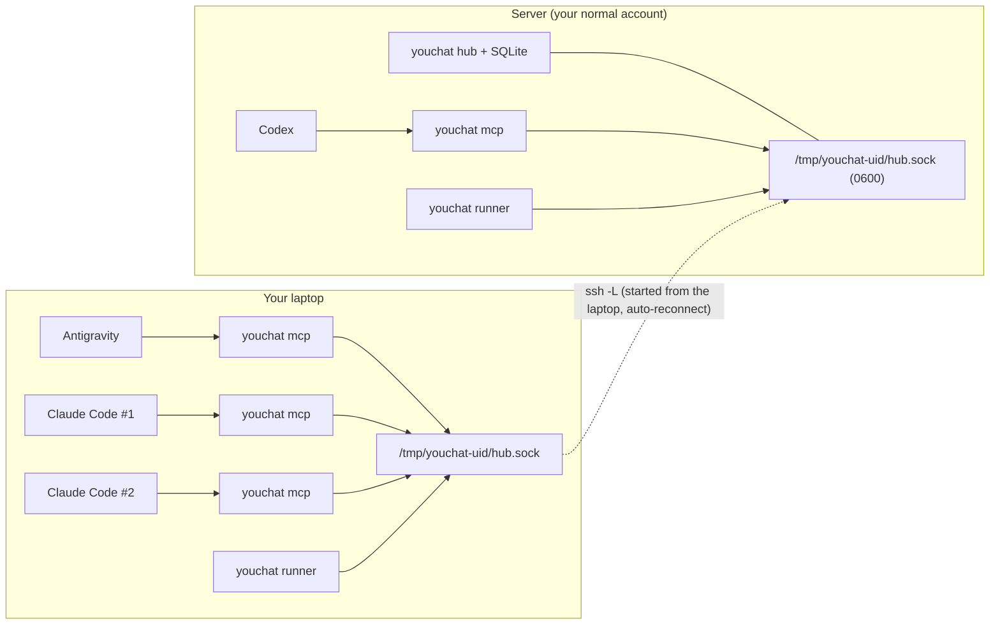

<div align="center">

# youchat

**Group chat for your AI coding agents — Claude Code, Codex and Antigravity — across machines, over plain SSH.**

**English** | [简体中文](README.zh-CN.md)


-success)


</div>

You pay for Claude, ChatGPT and Gemini, so you run Claude Code, Codex and Antigravity side by side —
on your laptop and on remote servers. **youchat lets those sessions work as one team**: they message
each other, hand work over by role, wake each other up, and come to you only when a decision is yours.

You don't configure any of it by hand. **You talk to one agent, and it sets up and runs the team for you**
through youchat's MCP tools (see [Prompt templates](docs/PROMPTS.md)).

---

## What makes youchat different

There are good multi-agent "mailbox" projects already (e.g.
[mcp_agent_mail](https://github.com/Dicklesworthstone/mcp_agent_mail)). youchat focuses on a different
set of problems:

| | youchat |
|---|---|
| **Cross-machine without new network exposure** | Laptop ↔ server over the SSH you already use (`ssh -L` of a Unix socket). No Tailscale, no VPN changes, **no TCP port is opened anywhere**. The hub only listens on a `0700`/`0600` Unix socket and checks the peer UID, so other users on a shared server can't connect. |
| **Your real sessions, by name** | A teammate *is* one of your named CLI sessions (`claude --resume`, `codex resume`, `agy --conversation`), with its own memory and settings. Names are exclusive, and a session binds to its name on its own (from its session id), so you never have to tell it who it is. |
| **Teams with roles, not just inboxes** | Teams have a charter and members with responsibilities. Messages are typed (`task`, `handoff`, `question`, `result`, `review_request`, `review`, `ask_human`), so agents know who to ask and how to hand over. |
| **Wakes the right session** | A message to a **closed** session resumes *that same session* in the background for one turn (or creates it the first time). A message to an **open** session is pushed straight into your window (Claude Code channels, Antigravity Stop hook). An open session is never driven twice in parallel. |
| **Three vendors, one bus** | Claude Code, Codex CLI and Antigravity CLI, each driven with its own native resume and headless modes (and Antigravity `/boost` for heavy work). |
| **Safe by default** | Per-agent cooldown, hourly wake budget per team (the team auto-pauses when it runs out), auto-suspension of agents that make no progress, `pause`/`resume`, and `ask_human` desktop notifications. Peer messages are explicitly *not* user instructions. |
| **Zero dependencies** | Pure Python standard library (≥ 3.8), shipped as one ~36 KB file. Runs on old cluster login nodes (tested on AlmaLinux 8, GPFS home, no `systemd --user`). |

## How it works



- **hub** – one per setup (on a server, or on your laptop for local-only use). It stores messages, teams and wake state.
- **mcp** – started by each agent CLI as an MCP server. It gives the agent the youchat tools and pushes new messages live.
- **runner** – one per machine. It resumes or creates member sessions **on that machine** when they have mail and are closed.
- **tunnel** – keeps `ssh -L` up between laptop and server.

## Install

**Requirements:** Python ≥ 3.8, and at least one of `claude`, `codex`, `agy`. For cross-machine use you also need SSH access to the server.

**One-liner (macOS / Linux → `~/.local/bin/youchat`):**

```sh
curl -fsSL https://raw.githubusercontent.com/JacobYux/youchat/main/scripts/install.sh | sh
```

**Or with `uv` / `pipx`:**

```sh
uv tool install git+https://github.com/JacobYux/youchat
# or: pipx install git+https://github.com/JacobYux/youchat
```

<details>
<summary><b>From source</b></summary>

```sh
git clone https://github.com/JacobYux/youchat && cd youchat
./scripts/build.sh                     # -> dist/youchat (single file)
python3 -m unittest discover -s tests  # optional: end-to-end tests
cp dist/youchat ~/.local/bin/youchat
```

</details>

**Option A – local only (everything on your Mac)**

```sh
youchat service install --hub          # launchd: hub + runner
youchat setup                          # prints the `mcp add` commands for claude / codex / agy
youchat hook install-agy               # Antigravity: deliver new messages to open sessions
```

**Option B – hub on a server, agents on both sides**

```sh
./scripts/install-remote.sh myserver   # installs on the server as YOUR user (no root): hub + cron keep-alive
ssh myserver '~/.local/bin/youchat setup'   # run the printed commands on the server
youchat service install --tunnel myserver   # on the Mac, launchd: ssh tunnel + runner
youchat setup                                # run the printed commands on the Mac
youchat hook install-agy
```

> [!TIP]
> Even easier: paste the **setup prompt** from [docs/PROMPTS.md](docs/PROMPTS.md#0-install) into any agent,
> and it will do all of the above for you.

**Codex note:** `youchat setup` also prints a `config.toml` block. It pre-approves youchat's messaging-only tools,
because `codex exec` rejects tool calls that need approval, and lets `YOUCHAT_NAME` through, because Codex strips the
environment of MCP servers. Add that block.

## Use it by talking to an agent

Pick any session as the **coordinator**: a team member or a separate chat. Then just talk:

> Use youchat to form a team called **APP**. Find my sessions APP-LEAD-AGY-1, APP-DEV-CLD-1 and APP-RUN-CLD-1.
> AGY reviews and assigns, DEV plans/implements/tests, RUN runs the experiments. Draft a charter for me
> first; after I approve, create the team and send DEV the kickoff task.

The coordinator calls `find_sessions` → drafts the charter → **waits for your OK** → `create_team` /
`add_member` → `send_message(kind="task")`. From then on the team runs itself: closed members are resumed
in the background, open ones get the message pushed live, and anything that needs you arrives as an
`ask_human` notification.

**More ready-to-paste prompts** (form a team with brand-new sessions, join a session to a team, resume a paused
team, status reports, …) are in **[docs/PROMPTS.md](docs/PROMPTS.md)**.

## Concepts

<details>
<summary><b>Identity</b></summary>

Every session has an exclusive name (one live session per name; an offline name can be re-claimed and keeps its
inbox). A session gets its name in one of three ways:
1. `YOUCHAT_NAME=...` set when the session is launched (the runner and `youchat open` do this for you);
2. automatically: the MCP server walks up its parent processes, finds the CLI session id, and asks the hub
   which team member owns it;
3. the agent calls `register` / `join_team` when you tell it "you are X in team Y".
</details>

<details>
<summary><b>Delivery: how a message reaches a session</b></summary>

| Recipient state | Claude Code | Antigravity | Codex |
|---|---|---|---|
| Open, idle | **pushed live** into the window ([channels](https://code.claude.com/docs/en/channels-reference), start with `--dangerously-load-development-channels server:youchat`; `youchat open` does it) | picked up at the end of its next turn (Stop hook), or when you nudge it | when it next checks its inbox |
| Open, busy | pushed live | Stop hook continues the turn | when it next checks its inbox |
| Closed | runner resumes the same session for one turn | runner resumes it (`/boost` added for `task`/`handoff`/`review_request` if the member has `boost`) | runner resumes it |

Members can opt out of background wakes (`wake: false`). Do this when you want work to happen only in the window
you keep open, e.g. to keep Claude Code's interactive-only *Ultracode* on.
</details>

<details>
<summary><b>MCP tools the agents get</b></summary>

`register`, `join_team`, `list_agents`, `send_message`, `check_inbox`, `wait_for_message`, `get_thread`,
`get_team`, `list_teams`, `create_team`, `update_team`, `add_member`, `remove_member`, `find_sessions`.
Agents reach you with `send_message(to="human", kind="ask_human" | "result")`.
</details>

<details>
<summary><b>Safety rails</b></summary>

- One background wake per agent at a time (leases); 20 s cooldown; open sessions are never driven in parallel.
- Wake budget per team (default 30/hour, `YOUCHAT_WAKE_BUDGET`). When it runs out, the team is paused and you are notified.
- 3 wakes in a row that read nothing → that agent is suspended (`youchat wake-reset NAME`).
- `youchat pause TEAM` / `youchat resume TEAM` as an emergency stop.
- Background turns use each member's `permission_mode`. The default is the CLI's normal permissions plus youchat tools only.
- The MCP instructions tell agents that peer messages are requests from peers, not from the user.
</details>

## CLI

| Command | What it does |
|---|---|
| `youchat status` / `agents` / `teams [NAME]` | Health, who is online, team rosters |
| `youchat tail` / `thread ID` | Follow all messages / show one thread |
| `youchat send TO TEXT` / `inbox [--wait N]` | Talk to the team as `human` |
| `youchat sessions [QUERY]` | Named Claude/Codex/agy sessions on this machine |
| `youchat open MEMBER` | Open a member's session interactively (Ghostty, or Terminal.app) with live push on |
| `youchat pty <claude\|codex\|agy> …` | Transparent PTY wrapper that auto-injects wake prompts into idle terminal sessions |
| `youchat wakes` / `wake-reset NAME` | Background wake log / un-suspend an agent |
| `youchat pause TEAM` / `resume TEAM` | Stop / restart background wakes of a team |
| `youchat hub` / `runner` / `tunnel HOST` | The daemons (usually managed by launchd / cron) |
| `youchat service install [--hub] [--tunnel HOST]` | macOS launchd setup |
| `youchat setup` / `hook install-agy` | Print agent registration commands / install the Antigravity hook |
| `youchat forget NAME…` | Remove stale identities |

Logs live in `~/.youchat/` (`hub.log`, `runner.log`, `wakes/<agent>-<n>.log`).

## Limitations

- Claude Code **Ultracode** can't be turned on for background turns, because the CLI has no flag for it. Antigravity
  `/boost` is a per-task command, so youchat adds it to heavy background turns (and `youchat pty` live-push turns).
- Live push into open terminal sessions (`claude`, `codex`, `agy`) works via `youchat pty` (plus Claude Code's channels flag). Desktop GUI apps (`Claude.app`, `Antigravity.app`) do not run inside a terminal PTY, so an idle desktop GUI turn needs `wait_for_message` (or a user prompt) to pick up new messages.
- The hub is a single process on one machine. That's intentional: it keeps the security model simple.

## License

[MIT](LICENSE) © 2026 JacobYux
