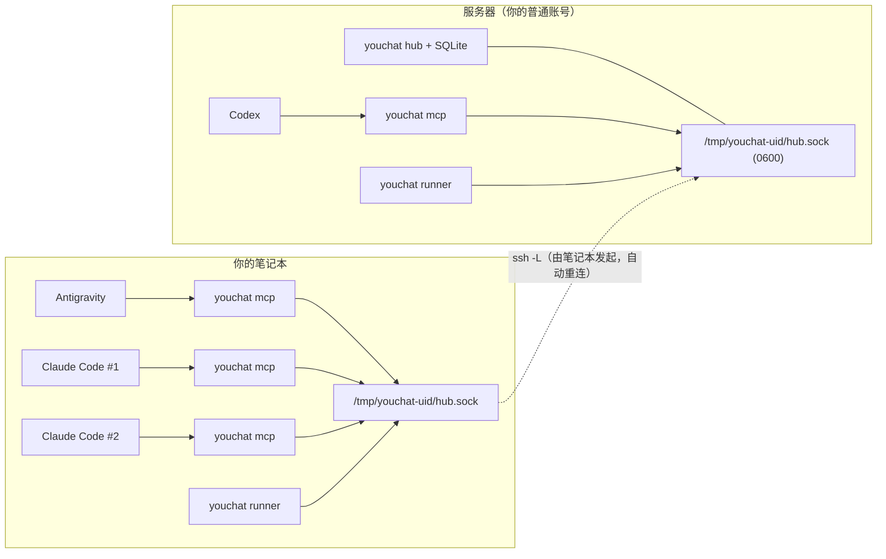

<div align="center">

# youchat

**让 Claude Code、Codex、Antigravity 组成一个能跨机器协作的 AI 开发小组——只需要你已有的 SSH。**

[English](README.md) | **简体中文**


</div>

你同时订阅了 Claude、ChatGPT 和 Gemini，于是在笔记本和远程服务器上同时开着 Claude Code、Codex、Antigravity 的多个对话。
**youchat 让这些对话像一个团队一样工作**：互相发消息、按分工交接、互相唤醒，只有需要你拍板的事情才来找你。

整个过程你不用手写任何配置。**你只需要和其中一个 agent 聊天，它会通过 youchat 的 MCP 工具替你组建并运转小组**（见[提示词模板](docs/PROMPTS.zh-CN.md)）。

---

## youchat 的特色

已经有不错的多 agent "邮箱"类项目（例如 [mcp_agent_mail](https://github.com/Dicklesworthstone/mcp_agent_mail)）。youchat 关注的是另一组问题：

| | youchat |
|---|---|
| **跨机器，但不新增任何网络暴露面** | 笔记本 ↔ 服务器只走你已有的 SSH（`ssh -L` 转发 Unix socket）。不需要 Tailscale，不改 VPN，**任何机器上都不开 TCP 端口**。hub 只监听权限为 `0700`/`0600` 的 Unix socket，并校验对端 UID，共享服务器上的其他用户连不进来。 |
| **成员就是你真实的、有名字的对话** | 小组成员就是你某个具名的 CLI 对话（`claude --resume` / `codex resume` / `agy --conversation`），带着它自己的记忆和设置。名字独占；对话会根据自己的 session id 自动绑定身份，不用你告诉它"你是谁"。 |
| **有分工的小组，而不只是收件箱** | 小组有章程，成员有职责；消息分类型（`task` 派任务、`handoff` 交接、`question` 提问、`result` 结果、`review_request` 提交验收、`review` 验收结论、`ask_human` 请示你），agent 知道该找谁、怎么交接。 |
| **唤醒的是正确的那个对话** | 发给**已关闭**对话的消息，会在后台恢复**同一个**对话跑一轮（第一次则新建）；发给**开着**的对话，会直接推进你的窗口（Claude Code channels、Antigravity Stop hook）。开着的对话永远不会被两处同时驱动。 |
| **三家厂商，一条总线** | Claude Code、Codex CLI、Antigravity CLI 各用自己原生的恢复/无头模式驱动（重活自动加 Antigravity `/boost`）。 |
| **默认安全** | 单成员冷却、每组每小时唤醒预算（用完自动暂停小组）、连续空转自动暂停该成员、`pause`/`resume` 急停、`ask_human` 桌面通知；并明确告诉 agent：同伴的消息**不是**用户指令。 |
| **零依赖** | 纯 Python 标准库（≥3.8），打包成一个约 36 KB 的单文件。能在老旧的集群登录节点上运行（已在 AlmaLinux 8、GPFS 家目录、没有 `systemd --user` 的环境实测）。 |

## 工作原理



- **hub**：整套只有一个（放在服务器上；纯本地使用时放在笔记本上），保存消息、小组和唤醒状态。
- **mcp**：每个 agent CLI 把它当作 MCP 服务器启动，给 agent 提供 youchat 工具，并实时推送新消息。
- **runner**：每台机器一个，成员对话关闭但有新消息时，在**那台机器上**恢复或新建对话。
- **tunnel**：维持笔记本到服务器的 `ssh -L`。

## 安装

**需要：** Python ≥ 3.8，以及 `claude`、`codex`、`agy` 中至少一个；跨机器使用还需要能 SSH 到服务器。

```sh
git clone https://github.com/JacobYux/youchat && cd youchat
./scripts/build.sh                     # 生成单文件 dist/youchat
python3 -m unittest discover -s tests  # 可选：20 个端到端测试
cp dist/youchat ~/.local/bin/youchat
```

**方式 A：纯本地（全部在你的 Mac 上）**

```sh
youchat service install --hub          # launchd 托管：hub + runner
youchat setup                          # 打印 claude / codex / agy 的 `mcp add` 命令
youchat hook install-agy               # Antigravity：把新消息送进开着的对话
```

**方式 B：hub 在服务器，两边都有 agent**

```sh
./scripts/install-remote.sh myserver        # 以你的普通账号安装到服务器（不需要 root）：hub + cron 保活
ssh myserver '~/.local/bin/youchat setup'   # 在服务器上执行打印出来的命令
youchat service install --tunnel myserver   # Mac 上 launchd 托管：ssh 隧道 + runner
youchat setup                               # 在 Mac 上执行打印出来的命令
youchat hook install-agy
```

> [!TIP]
> 更省事的办法：把 [docs/PROMPTS.zh-CN.md](docs/PROMPTS.zh-CN.md#0-安装) 里的**安装提示词**粘贴给任意一个 agent，让它替你完成以上全部步骤。

**Codex 注意：** `youchat setup` 还会打印一段 `config.toml` 配置，请一并加上。它做两件事：预先批准 youchat 的收发消息工具（因为 `codex exec` 会拒绝需要确认的工具调用），并放行 `YOUCHAT_NAME` 环境变量（因为 Codex 会清空 MCP 服务器的环境变量）。

## 用法：直接和 agent 对话

任选一个对话当**总控**，可以是小组成员，也可以是一个独立对话。然后直接说：

> 用 youchat 组建一个叫 **APP** 的小组。找到我的对话 APP-LEAD-AGY-1、APP-DEV-CLD-1、APP-RUN-CLD-1：
> AGY 负责审核和派活，DEV 负责计划/开发/测试，RUN 负责跑实验。先给我起草一份章程，我确认后再建组，并给 DEV 发开工任务。

总控会依次调用 `find_sessions` → 起草章程 → **等你确认** → `create_team` / `add_member` → `send_message(kind="task")`。
之后小组会自己运转：关着的成员在后台被恢复，开着的成员实时收到推送，需要你决定的事以 `ask_human` 通知的形式来找你。

**更多可直接粘贴的提示词**（用全新对话组建小组、让开着的对话入组、恢复暂停的小组、进度汇报……）见 **[docs/PROMPTS.zh-CN.md](docs/PROMPTS.zh-CN.md)**。

## 核心概念

<details>
<summary><b>身份</b></summary>

每个对话有一个独占的名字：同一时刻一个名字只能有一个在线对话；离线后可以重新认领，收件箱保留。对话通过以下三种方式之一获得名字：
1. 启动对话时设置 `YOUCHAT_NAME=...`（runner 和 `youchat open` 会自动设置）；
2. 自动识别：MCP 服务器沿父进程链找到 CLI 的 session id，再向 hub 查询它属于哪个成员；
3. 你对 agent 说"你是 Y 小组的 X"，它调用 `register` / `join_team`。
</details>

<details>
<summary><b>投递：消息如何到达对话</b></summary>

| 收件人状态 | Claude Code | Antigravity | Codex |
|---|---|---|---|
| 开着、空闲 | **实时推进窗口**（[channels](https://code.claude.com/docs/en/channels-reference)，需带 `--dangerously-load-development-channels server:youchat` 启动，`youchat open` 会自动加上） | 在它下一轮结束时被接上（Stop hook），或者你提醒它一句 | 等它下次查收件箱 |
| 开着、忙 | 实时推进 | Stop hook 让它接着处理 | 等它下次查收件箱 |
| 已关闭 | runner 在后台恢复同一对话跑一轮 | runner 恢复（成员开了 `boost` 时，遇到 `task`/`handoff`/`review_request` 自动加 `/boost`） | runner 恢复 |

成员可以设置不参与后台唤醒（`wake: false`）。如果你希望工作只发生在你开着的窗口里，就这样设置，例如为了保持 Claude Code 只能在交互模式下打开的 *Ultracode*。
</details>

<details>
<summary><b>agent 获得的 MCP 工具</b></summary>

`register`、`join_team`、`list_agents`、`send_message`、`check_inbox`、`wait_for_message`、`get_thread`、
`get_team`、`list_teams`、`create_team`、`update_team`、`add_member`、`remove_member`、`find_sessions`。
agent 用 `send_message(to="human", kind="ask_human" | "result")` 找你。
</details>

<details>
<summary><b>安全护栏</b></summary>

- 每个成员同一时间只有一个后台唤醒（租约机制）；两次唤醒间隔至少 20 秒；开着的对话永远不会被并行驱动。
- 每组唤醒预算（默认每小时 30 次，可用 `YOUCHAT_WAKE_BUDGET` 调整），用完后自动暂停小组并通知你。
- 连续 3 次唤醒都没读消息 → 暂停该成员（用 `youchat wake-reset NAME` 恢复）。
- `youchat pause TEAM` / `youchat resume TEAM` 作为急停开关。
- 后台运行使用每个成员各自的 `permission_mode`；默认是 CLI 的常规权限，额外只放行 youchat 自己的工具。
- MCP 说明里明确告诉 agent：同伴的消息是同伴的请求，不是用户的指令。
</details>

## 命令行

| 命令 | 作用 |
|---|---|
| `youchat status` / `agents` / `teams [NAME]` | 健康检查、谁在线、小组成员 |
| `youchat tail` / `thread ID` | 实时查看全部消息 / 查看某个线程 |
| `youchat send TO TEXT` / `inbox [--wait N]` | 以 `human` 身份和小组对话 |
| `youchat sessions [QUERY]` | 列出本机具名的 Claude/Codex/agy 对话 |
| `youchat open MEMBER` | 以交互方式打开成员的对话（Ghostty 或 Terminal.app），并开启实时推送 |
| `youchat pty <claude\|codex\|agy> …` | 透明 PTY 包装器：在打开的终端对话空闲时自动注入新消息唤醒词 |
| `youchat wakes` / `wake-reset NAME` | 后台唤醒记录 / 解除某成员的暂停 |
| `youchat pause TEAM` / `resume TEAM` | 停止 / 恢复某小组的后台唤醒 |
| `youchat hub` / `runner` / `tunnel HOST` | 后台进程（通常由 launchd / cron 托管） |
| `youchat service install [--hub] [--tunnel HOST]` | macOS launchd 配置 |
| `youchat setup` / `hook install-agy` | 打印 agent 注册命令 / 安装 Antigravity hook |
| `youchat forget NAME…` | 清理过期的身份 |

日志在 `~/.youchat/`（`hub.log`、`runner.log`、`wakes/<agent>-<n>.log`）。

## 已知限制

- Claude Code 的 **Ultracode** 无法在后台运行时打开，因为 CLI 没有对应参数。Antigravity 的 `/boost` 是一次性的任务命令，youchat 会在后台处理重活（以及 `youchat pty` 实时唤醒）时自动加上。
- 在终端（Ghostty / Terminal.app）里打开的 `claude`、`codex`、`agy` 对话均通过 `youchat pty`（及 Claude Code 的 channels 参数）支持实时自动唤醒；而桌面版 GUI（`Claude.app`、`Antigravity.app`）不运行在终端 PTY 中，若桌面版 GUI 结束回合处于空闲状态，需通过 `wait_for_message`（或人工发送一句提示）来拉取新消息。
- hub 是单机单进程。这是有意为之，为了让安全模型保持简单。

## 许可证

[MIT](LICENSE) © 2026 JacobYux
